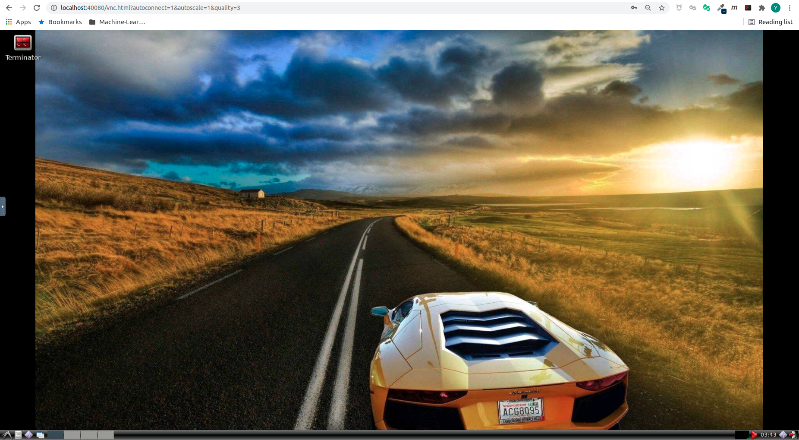

# Motion Planning for Mobile Robotics

Learning environment for Shenlan Academy's [Motion Planning for Mobile Robotics](https://www.shenlanxueyuan.com/course/398) course.

Designed & Implemented by **Ge Yao**, alexgecontrol@qq.com

---

## Overview

This repository serves as a learning environment for the [Motion Planning for Mobile Robotics](https://www.shenlanxueyuan.com/course/450) course, based on **ROS melodic** on **Ubuntu 18.04**. 

**Motion planning for mobile robotics involves complex environment dependencies**. However:

* Some dependencies are difficult to obtain directly due to network restrictions (Great Firewall & DNS Resolution Pollution)
* The versions of dependencies required by the course may be incompatible with those already present locally. Installing them blindly could potentially break your existing development environment

Therefore: This learning environment will be provided as a **Docker Image** to ensure isolation from the native PC environment. 

* This project assumes **Ubuntu** as the native PC operating system. Windows and macOS have not been tested and are not planned for migration or maintenance. If you wish to try them, please search for relevant solutions on your own.

**If you insist on developing on a native PC**, this repository **assumes you have sufficient experience in maintaining localization & mapping development environments, can customize the development environment yourself, and are capable of independently resolving various issues caused by dependency conflicts**. Please:

* Prepare the development environment yourself based on the Dockerfile [here](docker/cpu.Dockerfile)
* Be familiar with the various dependency libraries, and be able to independently search for relevant documentation and resolve dependency conflicts when issues arise

---

### Install Ubuntu

First, ensure you have access to an **Ubuntu** development environment. If you do not have an **Ubuntu** environment, please follow the [guide linked here](ubuntu-setup/README.md) to install and configure an **Ubuntu** environment on your local PC.

---

### Obtain Docker Development Environment

This course recommends using the accompanying Docker environment [linked here](docker/README.md) to complete the coursework. Docker provides a lightweight, standardized development environment that avoids many issues caused by configuration discrepancies.

---

### Workspace

Once both the native PC and the course Docker environment are ready, you can complete the coursework using the **local VSCode development, compile and test inside Docker** workflow.

#### Development, Compilation, and Testing

After starting the Docker environment, the `workspace` directory in **this repository** will be mounted to the `/workspace` directory inside **Docker**.

The steps for development, compilation, and testing using this workspace are as follows:

* Start [VSCode](https://code.visualstudio.com/) from the **workspace directory of this repository** to edit the source code:

* Perform compilation inside the **Docker /workspace** directory. For specific compilation instructions, please refer to [Assignment 1: Environment Setup](workspace/assignments/01-env-setup/ROS/README.md)

---

Keep Learning & Keep Coding

Ge Yao, alexgecontrol@qq.com
